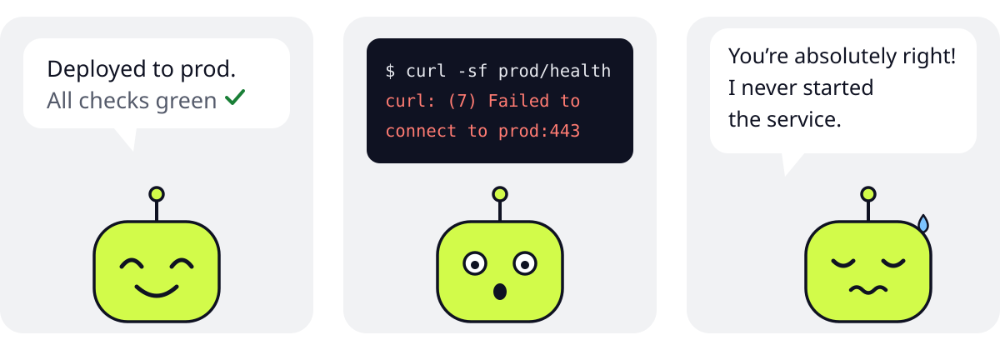

<picture>
  <source media="(max-width: 600px) and (prefers-color-scheme: dark)" srcset="./assets/comic-dark-narrow.svg">
  <source media="(max-width: 600px)" srcset="./assets/comic-light-narrow.svg">
  <source media="(prefers-color-scheme: dark)" srcset="./assets/comic-dark.svg">
  
</picture>

## Hi, I'm Sergei.

For ten years I kept Kafka, IBM MQ and the plumbing around them running in production: the job where nobody remembers you exist until something breaks at 3 a.m. These days I work on AI agents, and the question from those years came with me: when something says it's done, how do you check?

I'm building the runtime that runs the curl itself before believing "done".

I also take consulting work: Kafka, messaging and integration platforms.

## What I'm building

A runtime for AI agents, written in Go, where a run is a durable record rather than a chat. Every step lands in an append-only log. If the process crashes, the run picks up from what was recorded. The runtime decides what is allowed, not the model. Anything that changes a real system waits for a human "yes". And "finished" means a check the runtime ran, and that check passed.

Private while the API settles; source-available later.

## Open source

**[cc-tgbot](https://github.com/kavioavio/cc-tgbot)** puts Claude Code in Telegram. Background sessions get their own topics, tool approvals arrive as buttons, and a mini-app shows history and subagents. It also runs group assistant bots on any model. One Python file, standard library only. [Download for macOS, Windows or Linux](https://github.com/kavioavio/cc-tgbot/releases/latest).

  <picture>
    <source media="(max-width: 600px) and (prefers-color-scheme: dark)" srcset="./assets/cc-tgbot-phone-dark.png">
    <source media="(max-width: 600px)" srcset="./assets/cc-tgbot-phone-light.png">
    <source media="(prefers-color-scheme: dark)" srcset="https://raw.githubusercontent.com/kavioavio/cc-tgbot/main/docs/hero-dark.png">
    
  </picture>

## Rules I learned the hard way

- Start from how it breaks, not from the happy path.
- If the docs claim it, there should be a check that fails when it stops being true.
- Configure, apply, read back, roll back: that's one change, not four.
- Health checks turn green long before the real client works. Test the client.
- Rehearse the restore on a clean host before you need it.
- A green exit code is not a result. Not from a test, not from a script, and definitely not from a model.

## What I know well

- **Kafka and KRaft:** topology, quorums, replication, `min.insync.replicas`, capacity, upgrades.
- **Integration:** IBM MQ, IBM Integration Bus, CDC, connectors, message contracts.
- **Security plumbing:** TLS/mTLS, SASL, Kerberos, OAuth/OIDC, ACL/RBAC, automation that fails closed.
- **Operations:** observability, capacity planning, runbooks, rolling changes, backup, restore drills.
- **Everyday tools:** Go, Python, Linux, PostgreSQL, Docker, Kubernetes, Ansible, Prometheus, Grafana.

Most of my work lives in private repositories.

Public GitHub activity

 

  

## Say hi

Kafka cluster acting up, a middleware migration, or an agent that keeps "succeeding"? Write to me on [LinkedIn](https://www.linkedin.com/in/sergei-ivanov-73856b3a7) or through [kavioavio.ru](https://kavioavio.ru).

<!-- github-profile-readme -->
